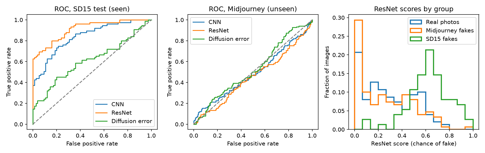
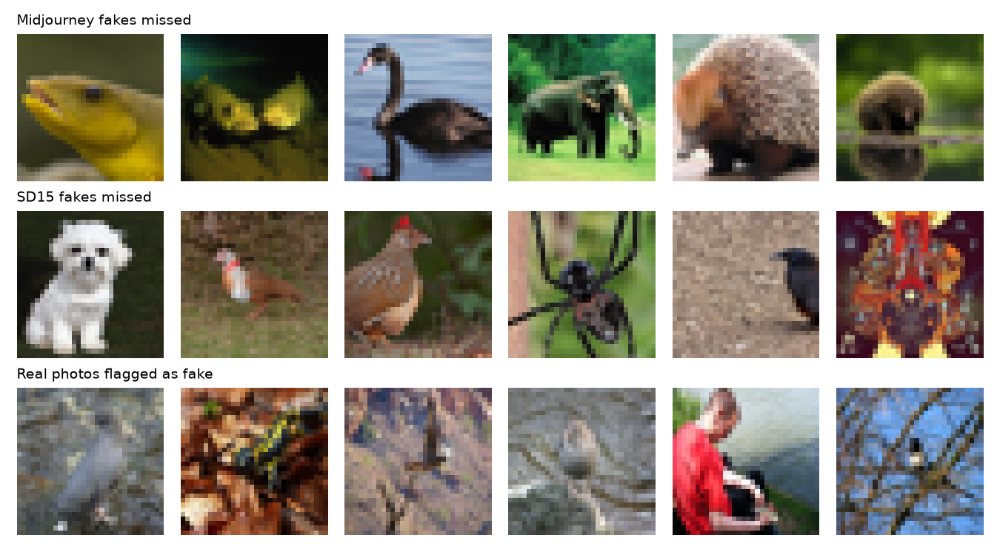

# Detecting AI-Generated Images Under Generator Shift: A CNN, a ResNet and a Diffusion Reconstruction-Error Detector

FA26 COMP 671 Deep Learning, Final Project

Author: Muthineni

## Abstract

AI image generators appear faster than detectors can be retrained, so a useful detector must work on generators it has never seen. This project tests that on Tiny-GenImage, using 32x32 images. Three detectors are trained on real photographs and fakes from Stable Diffusion 1.5 (SD15) and then tested on held-out SD15 images and on fakes from Midjourney, which none of them saw in training. The detectors are a small CNN (89,249 parameters), a small ResNet with skip connections (77,121 parameters), and a logistic regression on the reconstruction error of a pretrained diffusion model (DDPM) at noise level t=410. On SD15 the ResNet scores best (accuracy 0.793, AUROC 0.911), followed by the CNN (0.747, 0.840) and the diffusion detector (0.600, 0.614). On Midjourney all three fall to chance (accuracy 0.513, 0.477 and 0.507). The ResNet has the largest drop, so the residual architecture did not help on the unseen generator. The diffusion detector drops least only because it starts lowest. Midjourney fakes receive about the same average fake score as real photos, so the models treat them as ordinary photographs. SD15 fakes also had a higher, not lower, reconstruction error than real photos. The results come from one training run per model and 150 Midjourney fakes, so small differences should not be over-read, but the failure to transfer is large and consistent across all three detectors.

## 1. Problem Statement and Motivation

**Task.** The input is a single RGB image, resized to 32x32 pixels. The output is one label: real photograph or AI-generated. A detector is only useful if it keeps working on images from generators it was not trained on.

**Why it matters.** Realistic generated images can be used to spread false information. The authors of the GenImage benchmark point to fabricated photographs of the Pentagon on fire that circulated on social media [2]. New generators keep appearing, so a detector that only recognizes the generator it was trained on loses its value when the next one is released.

**Prior work.** Ojha et al. [1] show that a deep network trained for real-versus-fake classification on one family of generators fails on newer families, and that the real class ends up acting as a catch-all for any image that lacks the training generator's fingerprints. GenImage [2] turns this into a benchmark task, cross-generator classification, in which a detector is trained on one generator and tested on others. DIRE [3] proposes a different image representation: the error between an image and its reconstruction by a pretrained diffusion model. Its authors observe that diffusion-generated images can be approximately reconstructed while real images cannot, and report that the representation also works on diffusion models not seen in training.

**Research question.** Does the way a detector represents an image change how well it transfers to an unseen generator? This project compares two representations, raw pixels (a CNN and a ResNet) and diffusion reconstruction error, under one controlled shift: training on Stable Diffusion 1.5 (SD15) and testing on Midjourney.

**What this project is not.** It is not a reproduction of DIRE. It uses a simplified version of the idea: one noising step at a fixed noise level, a diffusion model pretrained on CIFAR-10-size images, and 32x32 inputs, so that everything runs on a laptop. The results are a small-scale test of the idea.

**Success criteria.** The primary metrics are accuracy and AUROC on two test sets: held-out SD15 images (seen generator) and Midjourney images (unseen generator). F1 and confusion matrices support them. The key quantity is the generalization gap, the seen score minus the unseen score. A detector counts as generalizing if its Midjourney AUROC is clearly above 0.5. With 150 real and 150 fake test images, an AUROC between about 0.43 and 0.57 cannot be told apart from chance (a rough 95% band from the normal approximation of the AUROC when there is no signal).

**Scope.** The project uses 1,050 images and three small models that train in minutes on a laptop, so every experiment can be repeated and inspected within a semester.

## 2. Data Description

**Source.** The data is Tiny-GenImage, hosted on Hugging Face by TheKernel01. Its dataset card lists the Kaggle dataset yangsangtai/tiny-genimage as the original source and does not say how the images were sampled. Its generator names match those of the GenImage benchmark [2]. It has 35,000 rows (28,000 in a train split, 7,000 in a validation split), takes 8.36 GB, and is licensed CC BY-NC-SA 4.0, which allows non-commercial use only. Image widths in the dataset viewer range from 34 to 4,790 pixels.

**Columns.** Each row has three fields: `image`, `label` (0 = real, 1 = fake) and `generator` (Real, ADM, BigGAN, GLIDE, Midjourney, SD14, SD15, VQDM or Wukong). The label is the prediction target. The generator column is never given to a model. It is only used to choose which images go into training and which are held back for the unseen-generator test.

**Row order.** Only the dataset's train split is used, and the project makes its own validation and test splits from it. In the first 2,000 rows, real and fake images alternate, with exactly 1,000 of each. The fakes are spread evenly over seven generators (142 or 143 images each): ADM, BigGAN, GLIDE, Midjourney, SD15, VQDM and Wukong. SD14 did not appear in these rows. We did not check the rest of the dataset, and SD14 is not used. The metadata table had no missing values.

**Subset.** The notebook streams the train split instead of downloading the full 8.36 GB, and keeps the first 525 real, 375 SD15 and 150 Midjourney images it meets. Each image is converted to RGB, resized to 32x32 pixels without cropping (so non-square images are stretched), and scaled from 0-255 to 0-1. The real and SD15 images are shuffled with NumPy seed 42 and divided as shown in Table 1. The Midjourney images are used only for the final unseen-generator test.

| Split | Real images | Fake images | Used for |
|---|---|---|---|
| Train | 225 | 225 (SD15) | fitting the models |
| Validation | 75 | 75 (SD15) | early stopping and choosing the noise level |
| Test, seen generator | 75 | 75 (SD15) | final score on the training generator |
| Test, unseen generator | 150 | 150 (Midjourney) | final score on a new generator |

*Table 1. Data splits. No image appears in two splits, and Midjourney images appear only in the unseen-generator test. The real photographs in the unseen test are different from those used in training.*

**Integrity checks.** The notebook checks that the metadata table has no missing values, that no image contains NaN or infinite values, that every image has shape 32x32x3 with pixel values from 0 to 255 before scaling, that all 1,050 images are unique, that every split is balanced, and that no image is shared between any two of the four splits. The duplicate check compares exact pixel values after resizing, so near-duplicates would not be caught.

**Limits of the data.** The subset is small (1,050 images) and takes the first matching rows in stream order, so its object categories may not be representative; the example images we inspected were mostly animals. Resizing to 32x32 removes fine detail, and the low-level fingerprints that detectors often rely on [1] may be lost. In the dataset viewer's first rows the real, SD15 and Midjourney images are all stored as JPEG, but other aspects of their compression history were not controlled. There is only one unseen generator.

## 3. Method and Model Design

**Overview.** Three detectors take the same 32x32 RGB image and output one number, the estimated chance that the image is fake. The CNN and the ResNet learn directly from pixels. The diffusion detector first turns each image into one number, its reconstruction error under a pretrained diffusion model, and then classifies that number. All three are trained only on real photographs and SD15 fakes.

**CNN baseline (course Chapter 10 [4]).** Convolutional layers reuse the same small filters at every position, which suits images [4]. The network has three blocks, each a 3x3 convolution, a ReLU and 2x2 max pooling, with 16, 32 and 64 channels. The resulting 64x4x4 feature map is flattened into 1,024 values, passed through a 64-unit hidden layer with ReLU and dropout 0.3, and reduced to one output value (a logit). It has 89,249 parameters. A sigmoid turns the logit into a probability of fake. It is the first detector a practitioner would try, and it is the kind of raw-pixel classifier whose poor transfer to new generators was reported in [1].

**Residual network (course Chapter 11 [4], [5]).** A residual block adds its input back to its output, so the layers only have to learn a change to the input, which makes deeper networks easier to train [5]. The ResNet here has a 3x3 convolution with 16 channels followed by three residual blocks (16, 32 and 64 channels, the last two with stride 2), each with two 3x3 convolutions. Where the shape changes, the skip path uses a 1x1 convolution. Global average pooling, dropout 0.3 and a linear layer give one logit. It has 77,121 parameters and no batch normalization. The comparison with the CNN is not a pure test of skip connections: the ResNet is also deeper, downsamples with strided convolutions instead of pooling, and uses global average pooling instead of a dense layer. It tests whether a residual architecture of similar size transfers better.

**Diffusion reconstruction-error detector (course Chapter 18 [4], [6]; idea from [3]).** A denoising diffusion model [6] is trained to predict the noise that was added to an image. We use the pretrained, unconditional model google/ddpm-cifar10-32 from Hugging Face (35,746,307 parameters, Apache-2.0 license), which was released for 32x32 images, and we do not train or fine-tune it. For each image x, scaled to the range -1 to 1, the detector does the following.

1. Add noise at a fixed noise level t = 410 out of the model's 1,000 steps: `x_t = sqrt(a_t) * x + sqrt(1 - a_t) * noise`, where `a_t` is the model's cumulative noise-schedule value at step t.
2. Let the model predict the noise from `x_t`.
3. Rebuild the image: `x_hat = (x_t - sqrt(1 - a_t) * predicted_noise) / sqrt(a_t)`.
4. Take the mean squared difference between `x_hat` and `x` over all pixels and channels. This one number is the reconstruction error of the image.

The noise is generated with fixed seeds, so the errors are repeatable. A logistic regression on the standardized error then predicts real or fake. This follows the idea of DIRE [3] in a much simpler form: a single noise-and-predict step on 32x32 images with a small pretrained model, so that it runs on a laptop. The noise level t = 410 was chosen by scanning 16 values and keeping the one with the highest validation AUROC for real versus SD15 images (0.647). Midjourney images were never used for this choice.

**Why these three.** Together they compare two ways of representing an image, raw pixels (CNN and ResNet) and a diffusion-based error score, under the same data and the same shift to an unseen generator.

## 4. Experimental Setup

**Protocol.** Each detector is fitted on the training split (225 real and 225 SD15 images), monitored on the validation split (75 and 75), and then scored on two held-out test sets (Table 1): the SD15 test set (75 and 75), which shows how well it works on the generator it was trained on, and the Midjourney test set (150 and 150), which shows how well it works on a generator it has never seen. The difference between the two scores is the generalization gap. No detector was tuned on either test set. An early check at t = 100 did print the mean reconstruction error of 100 Midjourney images, but the noise level was then chosen from validation scans on real and SD15 images alone. The ResNet was added after the CNN and diffusion results were known, to ask whether architecture could explain the failure. Its settings were copied from the CNN and not tuned.

**Training the CNN and the ResNet.** Both use the settings in Table 2. Dropout and early stopping act as regularizers (course Chapter 9 [4]).

| Setting | Value |
|---|---|
| Loss | binary cross-entropy on the logit |
| Optimizer | Adam, learning rate 0.001 |
| Batch size | 32 (training batches shuffled) |
| Maximum epochs | 30 |
| Early stopping | stop after 5 epochs without a lower validation loss, keep the weights with the lowest validation loss |
| Dropout | 0.3 |
| Hardware | laptop with an Apple GPU (PyTorch mps backend) |

*Table 2. Training settings shared by the CNN and the ResNet.*

The CNN stopped after epoch 17, and its best validation loss was 0.468, reached at epoch 12. The ResNet used all 30 epochs, and its best validation loss was 0.461, reached near the end of training (epochs 28 and 29), so the 30-epoch cap may have limited it. The cap was kept the same for both networks and was not extended.

**The diffusion detector.** No network is trained. The noise level was scanned over 16 values from 25 to 999 on the validation images, and t = 410 gave the highest validation AUROC (0.647). The classifier is a standardization step followed by scikit-learn's logistic regression with default settings, fitted on the 450 training errors. Its AUROC is 0.669 on the training split and 0.647 on the validation split.

**Metrics.** Accuracy, AUROC and F1 are computed for each detector on each test set, together with a confusion matrix. Accuracy, F1 and the confusion matrix use a probability cutoff of 0.5. Every test set is exactly balanced, so accuracy has a clear chance level of 0.5, and no class weights, oversampling or undersampling were used. AUROC measures how well a detector ranks fakes above real photos without depending on a cutoff, and it is also 0.5 at chance. F1 and the confusion matrix show what kind of mistakes a detector makes. With 75 real and 75 fake images, an AUROC between about 0.41 and 0.59 cannot be told apart from chance; with 150 and 150 the band is about 0.43 to 0.57, and accuracy on 300 images between about 0.44 and 0.56 is also within chance. These are rough 95% bands from a normal approximation when there is no signal.

**Baselines and comparisons.** Always guessing one class gives 0.5 accuracy on these balanced sets. The three detectors share the same images, splits, test sets and metrics. The CNN and the ResNet also share every training setting, so that comparison asks whether a residual architecture transfers better. The diffusion detector differs in how the image is represented, so it asks whether a reconstruction-error score transfers better than pixels do.

**Reproducibility.** The data split uses NumPy seed 42, and the noise in the diffusion detector uses fixed seeds, so its errors are repeatable. The torch seed 42 was set before ResNet training but after the model was created, so it fixes the batch order and not the starting weights, and the CNN was not seeded. Re-training a network will therefore give slightly different numbers, and the reported results come from the saved weights in the repository. Package versions are pinned in requirements.txt and the settings are listed in config.yaml.

## 6. Failure Analysis and Limitations

**Scores by group.** Figure 5 shows how well the detectors separate the groups. On the SD15 test set the ROC curves of the three detectors rise above the diagonal, and on Midjourney they stay near it, which is what chance looks like. Table 7 shows the average chance of fake that the two networks gave to each group. Midjourney fakes received about the same average score as real photos (CNN 0.268 against 0.251, ResNet 0.264 against 0.287), while SD15 fakes received clearly higher scores (0.598 and 0.630). The networks were therefore not confidently wrong about Midjourney. They found nothing that set those images apart from real photos.

*Figure 5. ROC curves on the SD15 test set (left) and the Midjourney test set (middle), and the distribution of ResNet scores for real photos, Midjourney fakes and SD15 fakes (right). The dashed line is chance.*

| Group | CNN | ResNet |
|---|---|---|
| Real photos (from the Midjourney test set) | 0.251 | 0.287 |
| SD15 fakes | 0.598 | 0.630 |
| Midjourney fakes | 0.268 | 0.264 |

*Table 7. Average chance of fake given by each network to each group of images.*

**Example mistakes.** Figure 6 shows the first six mistakes of each kind made by the ResNet. The Midjourney fakes it missed look like ordinary animal photographs at 32x32 pixels, and nothing visible in them separates them from real photos. The real photos it flagged as fake are mostly blurry, low in contrast or cluttered, so softness or clutter may be read as a sign of an AI image, but with six pictures this is an observation and not a tested result. One missed SD15 fake is an obviously unnatural symmetric pattern, which suggests the detectors do not respond to visible oddness in a picture.

*Figure 6. Mistakes of the ResNet. Top row: Midjourney fakes called real. Middle row: SD15 fakes called real. Bottom row: real photos called fake. These are the first six of each kind, not a random sample.*

**What the failures suggest.** The result matches the finding in [1] that a real-versus-fake classifier tends to treat what it does not recognize as real. It is consistent with the networks having learned cues specific to SD15, but we did not test this, and other explanations are possible: differences in content or style between the SD15 and Midjourney images, the loss of fine detail at 32x32 pixels, or chance variation in small samples. The diffusion detector fails in a similar way. Its reconstruction error separates SD15 fakes from real photos (Table 6) but not Midjourney fakes, and its cutoff, set on SD15 data, labels about 40% of both groups of Midjourney images as fake (59 of 150 real photos and 61 of 150 fakes).

**Limitations.**

- The test sets are small (75 and 75 images for SD15, 150 and 150 for Midjourney), so differences of a few points between detectors are not meaningful.
- There is one seen and one unseen generator. The results show that these detectors did not transfer from SD15 to Midjourney, not that no detector can.
- Each model was trained once, and the CNN and the ResNet starting weights were not seeded, so run-to-run variation is unknown.
- The images are only 32x32 pixels, so fine detail was lost, and results may differ at full resolution.
- No hyperparameters were searched for any model, and the ResNet may have been limited by the 30-epoch cap.
- The CNN and the ResNet differ in more than skip connections, so the comparison does not isolate them. The proper ablation, a ResNet with the skip connections removed, was not run.
- The diffusion detector is a simplified version of the idea in [3], using a small model made for 32x32 images. It is not a reproduction of that work.
- The subset takes the first matching rows of the stream and the examples we inspected were mostly animals, so the conclusions may not apply to people, faces or other content.
