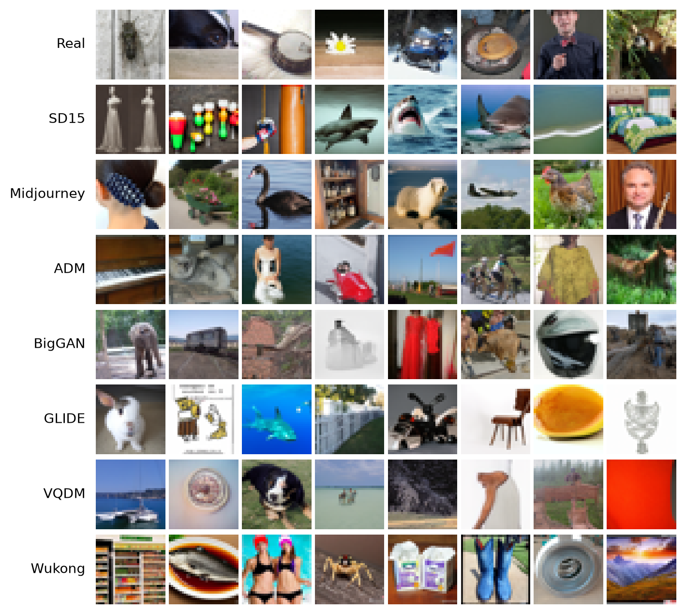
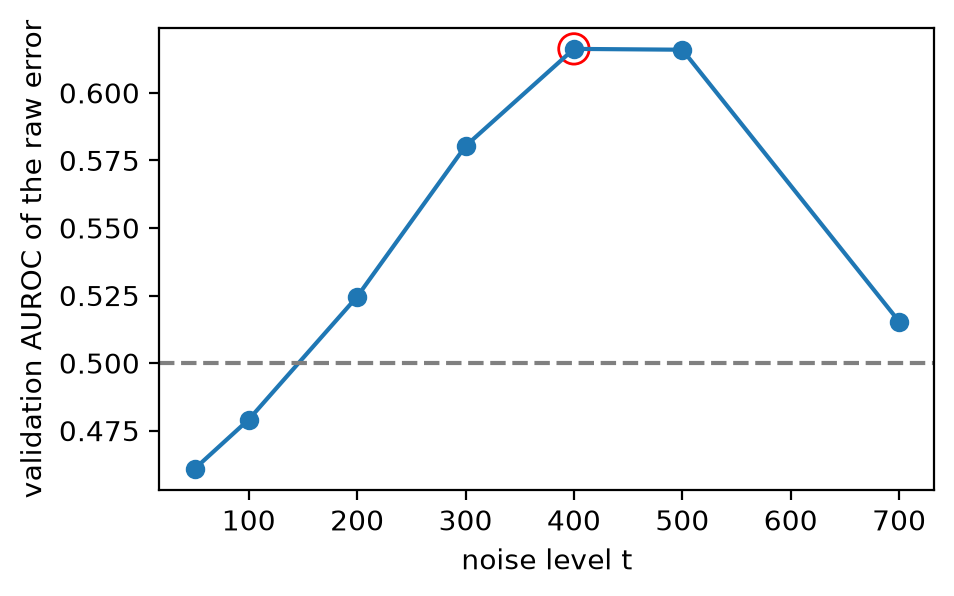
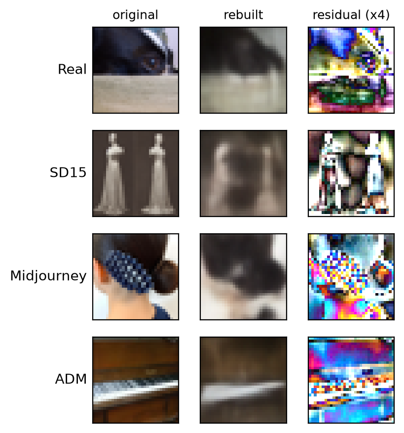
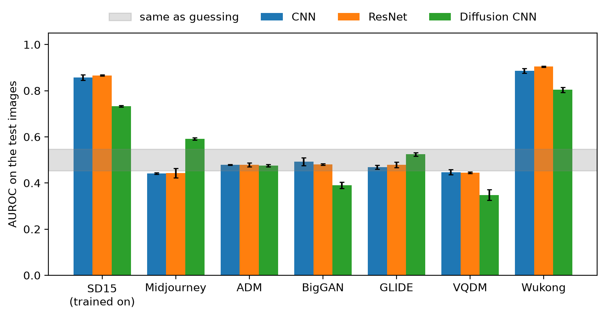
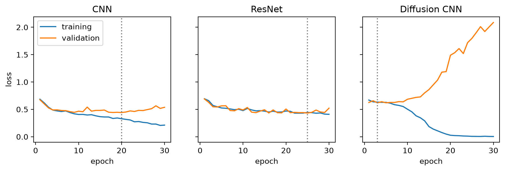
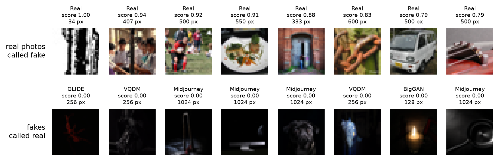
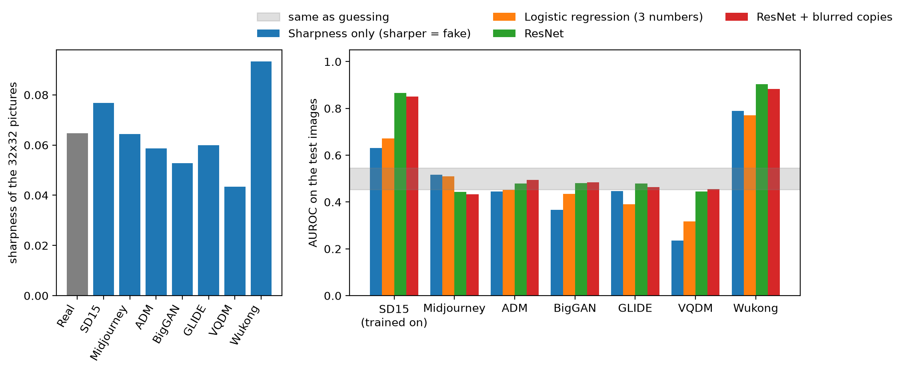

# Detecting AI-Generated Images Under Generator Shift

**A CNN, a ResNet and a diffusion-residual CNN trained on one generator and tested on six others**

Muthineni · COMP 671 Deep Learning, Fall 2026 · final project · code, data sample and weights: this repository, notebook `notebooks/Proj.ipynb`

## Abstract

An image detector is usually trained on fakes from one generator, but it is used on images from many. This project measures how much a detector loses when the generator changes. Using the Tiny-GenImage dataset [7], three small networks are trained on real photographs and Stable Diffusion 1.5 (SD15) fakes at 32 x 32 pixels: a plain CNN, a ResNet and a CNN that looks at the reconstruction error of a pretrained diffusion model. They are tested on SD15 and on six generators they never saw (Midjourney, ADM, BigGAN, GLIDE, VQDM, Wukong). On SD15 the AUROC is 0.857 (CNN), 0.866 (ResNet) and 0.733 (diffusion CNN), and Wukong is detected about as well (0.886, 0.904, 0.804). On the other five generators all three models average 0.465 to 0.466, which is no better than guessing. The diffusion residual changes which generators are misjudged, not how many: it is above guessing on Midjourney (0.592) and well below guessing on BigGAN (0.390) and VQDM (0.348). A follow-up check shows that picture sharpness explains only part of the result and that training with blurred images does not help. A detector trained on one generator should not be trusted on another.

## 1. Problem and motivation

Generative models now produce images that people cannot easily tell from photographs, and new generators appear all the time. A detector is trained once, on the fakes that are available, and then meets images from generators that did not exist when it was trained. Earlier work found that detectors trained on one generator often fail on others [1, 2]. This project studies that failure in a small, controlled setting that can be rerun on a laptop CPU.

**Question.** If a detector is trained on real photographs and fakes from one generator (SD15), how well does it work on fakes from generators it has never seen?

**What is done.**

- A random sample of Tiny-GenImage is drawn and checked (Section 2).
- Three detectors are built, one for each of the course topics convolutional networks, residual networks and diffusion models (Section 3).
- Hyperparameters are tuned on a validation set that contains only real photos and SD15 fakes, and every final model is trained with three seeds (Section 4).
- The models are tested on SD15 and on six unseen generators, always against the same real test photos (Section 5).
- The failures are examined, and one explanation (picture sharpness) is tested (Section 6).

**What is not claimed.** The detectors are small and work on 32 x 32 images, so the results say how these detectors behave in this setting, not how full-size detectors behave. Section 6.3 lists the limits.

## 2. Data

**Dataset.** Tiny-GenImage [7] (CC BY-NC-SA 4.0) is a reduced version of the GenImage benchmark [2]. Every row has an `image`, a `label` (real or fake) and a `generator` name. The train split has 28,000 rows: 14,000 real photographs and 2,000 images from each of seven generators (ADM, BigGAN, GLIDE, Midjourney, SD15, VQDM, Wukong). The name of the generator is used only to split the data and to report results; no model ever receives it.

**Sampling.** The rows of the dataset are not in random order, so taking the first rows would give a biased sample. The notebook therefore reads the whole split once and keeps a uniform random sample of every generator (reservoir sampling: every row of a generator has the same chance of being kept). The sampled rows are spread over the whole split, from row 27 to row 27,995. Each kept image is cut to a centered square and shrunk once, with a bicubic filter, to 32 x 32 pixels. The same steps are used for real and fake images, and pixel values are scaled to 0 to 1. No augmentation is used. The sample is saved in `data/`, so the notebook does not need to stream the dataset again.

**Checks.** The sample has 3,800 images. There are no missing values in the table, no duplicate images, no single-colour images, and every label matches its generator name (Step 3 of the notebook). Because nothing is missing, the step that would fill missing values (the median for numbers, "unknown" for text) changes nothing.

**Split.** The 2,000 real and SD15 images are split at random, with half real and half fake in every part (seed 42): 1,100 for training, 300 for validation and 600 for testing. The 1,800 images of the six unseen generators are used only for testing. Table 1 gives the counts and Figure 1 shows examples.

*Table 1. Images used. The unseen generators are never used for training, validation, tuning or choosing the noise level.*

| Group | Images in the sample | Train | Validation | Test |
|---|---|---|---|---|
| Real photographs | 1,000 | 550 | 150 | 300 |
| SD15 (the training generator) | 1,000 | 550 | 150 | 300 |
| Midjourney, ADM, BigGAN, GLIDE, VQDM, Wukong | 300 each (1,800) | 0 | 0 | 300 each (1,800) |
| Total | 3,800 | 1,100 | 300 | 2,400 |



*Figure 1. Eight sample images of every group at 32 x 32, as the models see them (first row real photographs, second row SD15, then Midjourney, ADM, BigGAN, GLIDE, VQDM and Wukong).*

**A property of the data that matters.** Real photographs come in many sizes and are all JPEG files, while the images of each generator have one fixed size and are PNG files (Table 2). A detector could in principle learn the file type or the size instead of the generator. At 32 x 32 the file type and the original size are no longer visible, but the images were shrunk by very different factors (from 4x for BigGAN to 32x for Midjourney), and this may leave traces. Section 6.2 checks one such trace, the sharpness of the picture.

*Table 2. Original image sizes and file types of the sample (before the shrink to 32 x 32).*

| Group | Median width (px) | Smallest | Largest | Share JPEG | Shrink to 32 px (median) |
|---|---|---|---|---|---|
| Real | 500 | 34 | 4,786 | 100% | 16x |
| SD15 | 512 | 512 | 512 | 0% | 16x |
| Wukong | 512 | 512 | 512 | 0% | 16x |
| Midjourney | 1,024 | 1,024 | 1,024 | 0% | 32x |
| ADM | 256 | 256 | 256 | 0% | 8x |
| GLIDE | 256 | 256 | 256 | 0% | 8x |
| VQDM | 256 | 256 | 256 | 0% | 8x |
| BigGAN | 128 | 128 | 128 | 0% | 4x |

## 3. Method

Three detectors are compared (Table 3). All take a 32 x 32 RGB image and return one number, the probability that the image is fake.

*Table 3. The three detectors.*

| Model | Input | Course topic | Trainable parameters |
|---|---|---|---|
| CNN | pixels (3 x 32 x 32) | chapter 10, convolutional networks | 89,249 |
| ResNet | pixels (3 x 32 x 32) | chapter 11, residual networks | 77,121 |
| Diffusion CNN | diffusion residual (3 x 32 x 32) | chapter 18, diffusion models | 89,249 (the same CNN) |

**Model 1, CNN (chapter 10 of [4]).** Three blocks of a 3 x 3 convolution, a ReLU and a 2 x 2 max pooling, with 16, 32 and 64 channels, followed by a fully connected layer of 64 units with dropout and one output unit.

**Model 2, ResNet (chapter 11 of [4], [5]).** A 3 x 3 convolution with 16 channels, three residual blocks (16 to 16, 16 to 32 and 32 to 64 channels, the last two with stride 2), global average pooling, dropout and one output unit. Each block has two 3 x 3 convolutions and a skip connection that adds the block input to its output (a 1 x 1 convolution fixes the shape when it changes). The network has no batch normalisation.

**Model 3, diffusion CNN (chapter 18 of [4], [6]).** This detector uses the idea of DIRE [3]: a diffusion model rebuilds images better when they look like images it could have produced. A pretrained diffusion model, `google/ddpm-cifar10-32` [8], is used exactly as it is and is never trained here. For an image `x` scaled to -1..1 and a noise level `t`:

```
x_t     = sqrt(a) * x + sqrt(1 - a) * eps        a = alphas_cumprod[t], eps = random noise (fixed seed)
eps_hat = unet(x_t, t)                           the noise the diffusion model believes it sees
x_hat   = (x_t - sqrt(1 - a) * eps_hat) / sqrt(a)    the rebuilt image
residual = |x_hat - x|
```

The residual is standardised per colour channel with the mean and standard deviation of the training residuals, and the same CNN as in Model 1 is trained on it. This is a one-step simplification of DIRE, which uses a full reconstruction. Figure 2 shows how the noise level was chosen: for every candidate `t` the raw rebuilding error of each validation image (real photographs and SD15 only) is scored with AUROC, and the `t` that is furthest from 0.5 is kept. This gives `t` = 400 (validation AUROC 0.616; `t` = 500 is almost the same, 0.616). The raw error alone is therefore a weak signal. Figure 3 shows examples of originals, rebuilt images and residuals.



*Figure 2. Choosing the noise level on the validation images. The chosen value, t = 400, is circled. The dashed line is 0.5.*



*Figure 3. A test image of a real photograph, of SD15, of Midjourney and of ADM, shown as original, rebuilt image and residual (multiplied by 4 to be visible).*

## 4. Experimental setup

**Training.** All networks are trained with the Adam optimiser and binary cross-entropy, batch size 32, for at most 30 epochs, without a learning-rate schedule or augmentation. After every epoch the validation loss is computed and the weights of the epoch with the lowest validation loss are kept. A seed fixes the starting weights and the order of the batches. Training runs on the CPU.

**Tuning.** For every model the learning rate (0.001 or 0.0003) and the dropout rate (0.3 or 0.5) are tried, four runs per model, one seed each, and the setting with the highest validation AUROC is kept (Table 4). The unseen generators play no part in this choice. The differences inside a model are small (validation AUROC 0.879 to 0.889 for the CNN, 0.878 to 0.892 for the ResNet, 0.704 to 0.714 for the diffusion CNN), so the chosen settings are only slightly better than the others. The diffusion CNN reaches a much lower validation AUROC than the two pixel models.

*Table 4. Hyperparameter tuning on the validation images (one seed). The chosen setting of each model is marked.*

| Model | Learning rate | Dropout | Best epoch | Validation loss | Validation AUROC |
|---|---|---|---|---|---|
| CNN (chosen) | 0.001 | 0.3 | 20 | 0.442 | 0.889 |
| CNN | 0.001 | 0.5 | 18 | 0.436 | 0.884 |
| CNN | 0.0003 | 0.3 | 23 | 0.439 | 0.879 |
| CNN | 0.0003 | 0.5 | 23 | 0.442 | 0.879 |
| ResNet (chosen) | 0.001 | 0.3 | 25 | 0.433 | 0.892 |
| ResNet | 0.001 | 0.5 | 28 | 0.441 | 0.880 |
| ResNet | 0.0003 | 0.3 | 29 | 0.440 | 0.878 |
| ResNet | 0.0003 | 0.5 | 28 | 0.440 | 0.879 |
| Diffusion CNN | 0.001 | 0.3 | 6 | 0.622 | 0.704 |
| Diffusion CNN (chosen) | 0.001 | 0.5 | 3 | 0.620 | 0.714 |
| Diffusion CNN | 0.0003 | 0.3 | 8 | 0.623 | 0.704 |
| Diffusion CNN | 0.0003 | 0.5 | 8 | 0.622 | 0.707 |

**Final models.** Every model is trained again with its chosen settings and with three seeds (0, 1 and 2). Results are reported as mean and standard deviation over the seeds. The weights of all nine final models are saved in `models/`.

**Metric.** The metric is the AUROC [9]: the chance that a random fake gets a higher score than a random real photograph (1.0 is perfect, 0.5 is guessing). For every generator the AUROC compares its 300 test fakes with the same 300 real test photographs, so differences between generators come from the fakes only. With 300 real and 300 fake images, a detector without any signal has an AUROC of 0.5 with a standard deviation of 0.0236, so values between 0.454 and 0.546 cannot be told apart from guessing (95% band). This band describes the noise of the test sample only. The standard deviation over seeds is reported separately.

**What was decided when.** The settings (sample size, split, epochs, tuning grid, seeds) were fixed in `config.yaml` before the first run and were not changed afterwards. The only setting added later is the blur strength of the sharpness check in Section 6.2, which was added after the test results of Section 5 had been seen. That check was not used to choose or change any model.

## 5. Results

### 5.1 AUROC on seen and unseen generators

Table 5 and Figure 4 show the main result. All three models detect SD15, the generator they were trained on, well above guessing. The CNN and the ResNet are about equally good (0.857 and 0.866, standard deviation over seeds 0.012 and 0.002); the diffusion CNN is clearly lower (0.733, all three seeds between 0.729 and 0.735).

*Table 5. Test AUROC, mean ± standard deviation over three seeds. Each generator is compared with the same 300 real test photographs. Values between 0.454 and 0.546 cannot be told apart from guessing.*

| Model | SD15 | Midjourney | ADM | BigGAN | GLIDE | VQDM | Wukong |
|---|---|---|---|---|---|---|---|
| CNN | 0.857 ± 0.012 | 0.442 ± 0.004 | 0.479 ± 0.001 | 0.493 ± 0.017 | 0.469 ± 0.009 | 0.447 ± 0.012 | 0.886 ± 0.010 |
| ResNet | 0.866 ± 0.002 | 0.444 ± 0.021 | 0.479 ± 0.008 | 0.481 ± 0.004 | 0.479 ± 0.012 | 0.445 ± 0.004 | 0.904 ± 0.003 |
| Diffusion CNN | 0.733 ± 0.003 | 0.592 ± 0.005 | 0.475 ± 0.006 | 0.390 ± 0.014 | 0.524 ± 0.008 | 0.348 ± 0.023 | 0.804 ± 0.011 |



*Figure 4. Test AUROC of every model on SD15 (trained on) and on the six unseen generators. Error bars are the standard deviation over three seeds; the grey band is the range of guessing.*

Three things stand out.

1. **Wukong is detected about as well as SD15 or better** (0.886, 0.904, 0.804). The GenImage paper also reports that detectors trained on Stable Diffusion transfer to Wukong [2].
2. **On the five other generators the pixel models do not work.** The CNN and the ResNet score between 0.442 and 0.493. None is above the guessing band, and Midjourney and VQDM are slightly below it (0.442 and 0.447 for the CNN, 0.444 and 0.445 for the ResNet), which means that these fakes are ranked slightly more real than the real photographs.
3. **The diffusion CNN fails differently, not less.** It is above the band on Midjourney (0.592), inside it on ADM (0.475) and GLIDE (0.524), and far below it on BigGAN (0.390) and VQDM (0.348). A score that is far below 0.5 means the detector is consistently wrong about that generator: it finds those fakes more real than real photographs.

The mean over all six unseen generators (Table 6, "mean of all six") looks close to guessing (0.522 to 0.538), but it is misleading because it mixes Wukong, which works, with five generators that do not. The mean of the five others is 0.465 for the ResNet, 0.466 for the CNN and 0.466 for the diffusion CNN, below 0.5 for all three. The drop from SD15 is smaller for the diffusion CNN (0.210 against 0.321 and 0.328) only because it starts lower on SD15, not because it transfers better. With 300 test images per generator, and with the CNN and the ResNet only 0.003 apart in the mean over all six unseen generators, no model can be called best on the unseen generators.

*Table 6. Summary of Table 5. "Mean of the five others" leaves out Wukong. Drop is the SD15 AUROC minus the mean of all six unseen generators.*

| Model | SD15 (seen) | Wukong | Mean of the five others | Mean of all six unseen | Drop (SD15 minus six) |
|---|---|---|---|---|---|
| CNN | 0.857 | 0.886 | 0.466 | 0.536 | 0.321 |
| ResNet | 0.866 | 0.904 | 0.465 | 0.538 | 0.328 |
| Diffusion CNN | 0.733 | 0.804 | 0.466 | 0.522 | 0.210 |

### 5.2 How the models trained

Figure 5 shows the loss curves of seed 0. The CNN starts to overfit after about epoch 20 (its training loss keeps falling while its validation loss rises), and the ResNet's training and validation losses stay close together for most of the training. The diffusion CNN overfits very quickly: the lowest validation loss is reached at epoch 3 and the validation loss rises above 2.0 by epoch 30 while the training loss goes to nearly zero. The best epochs of the three seeds were 20, 15 and 16 for the CNN, 25, 29 and 19 for the ResNet and 3, 4 and 6 for the diffusion CNN. Keeping the best validation epoch therefore matters most for the diffusion CNN.



*Figure 5. Training and validation loss of the final models (seed 0). The dotted line marks the epoch whose weights were kept.*

### 5.3 What the numbers mean at a fixed cut-off

AUROC does not depend on a cut-off. To see what a user would experience, Table 7 uses the usual cut-off of 0.5 for the ResNet (average of the three seeds; the ResNet is shown because its mean on the unseen generators is nominally the highest, although the difference to the CNN is within noise). It calls 24.7% of the real test photographs fake. It finds 80.3% of the SD15 fakes and 86.7% of the Wukong fakes, but only 15.7% to 25.3% of the fakes of the other five generators, which is close to or below the share of real photographs that it flags. On those generators, a flagged image is hardly more likely to be fake than a real photograph.

*Table 7. ResNet at the cut-off 0.5 (scores averaged over the three seeds), shares of the 300 test images of each group.*

| What | Share |
|---|---|
| Real test photos wrongly called fake | 24.7% |
| SD15 fakes correctly called fake | 80.3% |
| Midjourney fakes correctly called fake | 24.7% |
| ADM fakes correctly called fake | 18.0% |
| BigGAN fakes correctly called fake | 19.3% |
| GLIDE fakes correctly called fake | 25.3% |
| VQDM fakes correctly called fake | 15.7% |
| Wukong fakes correctly called fake | 86.7% |

## 6. Failure analysis and limitations

### 6.1 Which images are misjudged

Figure 6 shows the most confident mistakes of the ResNet. The fakes that are called real with the most confidence (score 0.00) are all dark pictures, from GLIDE, VQDM, BigGAN and Midjourney, many with little visible detail. The real photographs that are called fake with the most confidence are ordinary photographs; the most extreme one is a real photograph whose original is only 34 pixels wide, so it is hardly shrunk at all. These are the extremes of the score range and not typical cases. They suggest that the detector reacts partly to low-level properties of the small picture, such as darkness and pixel structure, and not only to what the picture shows; this is an impression from 16 images, not a measurement.



*Figure 6. The eight real photographs with the highest fake score (top) and the eight fakes with the lowest fake score (bottom), with the generator, the score and the width of the original image.*

### 6.2 Is it just sharpness?

After seeing Table 5, one explanation seemed likely: the detectors follow how sharp the 32 x 32 picture is. SD15 and Wukong pictures are sharper than real photographs, and the other generators are not (Table 8). Two checks were run (Step 13 of the notebook).

1. **Detectors without deep learning.** One rule uses only the sharpness of the picture (the average difference between neighbouring pixels, sharper means fake). A logistic regression uses brightness, contrast and sharpness. The sharpness rule has no free parameters, and the logistic regression is fitted on the training images. Both are tested like the networks.
2. **A ResNet trained with blurred copies.** Every training image gets one blurred copy (Gaussian blur, random strength) so that sharpness is a weaker clue. Validation and test images are not blurred.

*Table 8. Average sharpness of the 32 x 32 pictures of every group (average absolute difference between neighbouring pixels, pixel values 0 to 1).*

| Group | Real | SD15 | Midjourney | ADM | BigGAN | GLIDE | VQDM | Wukong |
|---|---|---|---|---|---|---|---|---|
| Average sharpness | 0.0647 | 0.0768 | 0.0645 | 0.0586 | 0.0528 | 0.0600 | 0.0434 | 0.0932 |

*Table 9. Test AUROC of the sharpness checks, in the same way as Table 5. For the ResNet with blurred copies, the mean of three seeds is shown (standard deviation over seeds at most 0.008).*

| Detector | SD15 | Midjourney | ADM | BigGAN | GLIDE | VQDM | Wukong | Mean of the five others |
|---|---|---|---|---|---|---|---|---|
| Sharpness only (sharper = fake) | 0.631 | 0.517 | 0.446 | 0.366 | 0.447 | 0.236 | 0.789 | 0.402 |
| Logistic regression (3 numbers) | 0.672 | 0.509 | 0.452 | 0.434 | 0.390 | 0.318 | 0.770 | 0.421 |
| ResNet | 0.866 | 0.444 | 0.479 | 0.481 | 0.479 | 0.445 | 0.904 | 0.465 |
| ResNet + blurred copies | 0.850 | 0.434 | 0.494 | 0.484 | 0.465 | 0.455 | 0.882 | 0.466 |



*Figure 7. Left: average sharpness of every group. Right: test AUROC of the sharpness rule, the logistic regression, the ResNet and the ResNet trained with blurred copies.*

The result (Table 9, Figure 7) has three parts. First, the simple detectors show the same pattern as the networks, above guessing on SD15 (0.631 and 0.672) and Wukong (0.789 and 0.770) and not above guessing on the other five (mean 0.402 and 0.421). Sharpness therefore explains part of why Wukong is easy and why the other generators are not. Second, the ResNet is far better on SD15 (0.866) than the best simple detector (0.672), so it uses much more than sharpness. Third, training with blurred copies changes almost nothing: 0.850 on SD15 against 0.866, and 0.466 on the five others against 0.465. So sharpness alone is not what holds the ResNet back on the other generators. A likely explanation is that the networks learn patterns that are specific to Stable Diffusion images, which would also explain why Wukong transfers. This was not tested.

### 6.3 Limitations

- **Image size.** The images are only 32 x 32 pixels. Detectors in the literature rely on fine traces of the generator [1, 2] that this size removes. The size was chosen because the diffusion model works on 32 x 32 images and because all training had to run on a laptop CPU. The results may not carry over to full-size images.
- **One training generator and one sample.** Everything is trained on SD15 only, with 1,000 real and 1,000 SD15 images. Each unseen generator has 300 test images, so differences of a few hundredths in AUROC cannot be resolved (guessing band ±0.046). A different sample or a different training generator could give different numbers.
- **Differences between real and generated images that are not about generation.** Real photographs are JPEG files of many sizes and the fakes are PNG files of fixed sizes (Table 2). The shrink factors differ by group. Only sharpness was checked (Section 6.2); other traces of the resizing, the colour distribution or the picture content (the fakes may show different subjects than the real photographs) were not controlled.
- **The diffusion model.** It was trained on CIFAR-10 [8], which is a different kind of image, only one step and one noise level are used, and the noise is one fixed random draw. A full DIRE-style reconstruction [3] might do better. The raw error is a weak signal (validation AUROC 0.616).
- **Small tuning grid.** Only four settings per model were tried, with one seed. The differences between them are small, so the choice is nearly arbitrary.
- **Choices made after seeing test results.** The ResNet in Sections 5.3 and 6.1 was chosen because its mean on the unseen generators is nominally the highest, but it differs from the CNN by only 0.003. The sharpness check was added after Table 5 was seen (Section 4).
- **One kind of augmentation.** Blurring was the only augmentation tried. Other changes, for example JPEG compression or noise, were not.

## 7. Ethics

**Misuse of detectors.** A detector that fails on new generators can do real harm if it is used to judge a person. At the cut-off 0.5, the ResNet calls 24.7% of real photographs fake (Table 7), and on five of six unseen generators a flagged image is no more likely to be fake than a real one. Such a detector must not be used to accuse someone of faking an image, and an automatic "real" verdict must not be taken as proof that an image is genuine. Any real use would need images from the generators that matter, a calibrated cut-off, an estimate of the false-alarm rate and a human check.

**Data.** The images come from the public dataset Tiny-GenImage [7], which is licensed under CC BY-NC-SA 4.0 (attribution, non-commercial, share-alike). The 3,800 images saved in `data/` are 32 x 32 versions of images from that dataset and are kept only so that the coursework can be rerun, under the same license. No personal information was collected or added, and no attempt was made to identify any person in the images.

**Dual use.** Knowing where detectors fail could help someone who wants to avoid detection. This report describes failures in general terms, does not provide a method to generate images or to evade detection, and trains no generator.

**Environment.** The whole notebook runs on a laptop CPU in about 15 minutes, so the energy cost is small.

**Use of AI tools.** An AI coding assistant was used while developing the code and the text of this project. The notebook was run by the author, and every number in this report was produced by that run and is read from the result tables in `results/tables/`. `CHANGELOG.md` records what the assistant changed.

## 8. Conclusion

Three small detectors (a CNN, a ResNet and a CNN on diffusion residuals) were trained on real photographs and SD15 fakes at 32 x 32 pixels. They detect SD15 (0.733 to 0.866 AUROC) and the related Wukong generator (0.804 to 0.904), but not Midjourney, ADM, BigGAN, GLIDE or VQDM, where they average 0.465 to 0.466. The diffusion residual does not make the detector more general; it only changes which generators it gets wrong. Picture sharpness explains part of the pattern but not the failure of the ResNet, and blurred training images do not repair it. The main lesson for anyone who builds a detector is that a good score on the training generator says very little about new generators, so detectors need to be tested on generators they have not seen. Possible next steps are full-resolution images, several training generators, a full diffusion reconstruction and a test of the Stable Diffusion hypothesis, for example with a second Stable Diffusion version or a different sample of real photographs.

## References

[1] U. Ojha, Y. Li, and Y. J. Lee, "Towards universal fake image detectors that generalize across generative models," in Proc. IEEE/CVF Conf. on Computer Vision and Pattern Recognition (CVPR), 2023. arXiv:2302.10174.

[2] M. Zhu, H. Chen, Q. Yan, X. Huang, G. Lin, W. Li, Z. Tu, H. Hu, J. Hu, and Y. Wang, "GenImage: A million-scale benchmark for detecting AI-generated image," in Advances in Neural Information Processing Systems (NeurIPS), Datasets and Benchmarks Track, 2023. arXiv:2306.08571.

[3] Z. Wang, J. Bao, W. Zhou, W. Wang, H. Hu, H. Chen, and H. Li, "DIRE for diffusion-generated image detection," in Proc. IEEE/CVF Int. Conf. on Computer Vision (ICCV), 2023, pp. 22445-22455. arXiv:2303.09295.

[4] S. J. D. Prince, Understanding Deep Learning. Cambridge, MA, USA: MIT Press, 2023. [Online]. Available: http://udlbook.com

[5] K. He, X. Zhang, S. Ren, and J. Sun, "Deep residual learning for image recognition," in Proc. IEEE Conf. on Computer Vision and Pattern Recognition (CVPR), 2016, pp. 770-778. arXiv:1512.03385.

[6] J. Ho, A. Jain, and P. Abbeel, "Denoising diffusion probabilistic models," in Advances in Neural Information Processing Systems (NeurIPS), 2020. arXiv:2006.11239.

[7] TheKernel01, "Tiny-GenImage," dataset on the Hugging Face Hub, license CC BY-NC-SA 4.0. [Online]. Available: https://huggingface.co/datasets/TheKernel01/Tiny-GenImage (accessed Oct. 2026).

[8] Google, "google/ddpm-cifar10-32," pretrained model on the Hugging Face Hub, Apache-2.0 license. [Online]. Available: https://huggingface.co/google/ddpm-cifar10-32 (accessed Oct. 2026).

[9] J. A. Hanley and B. J. McNeil, "The meaning and use of the area under a receiver operating characteristic (ROC) curve," Radiology, vol. 143, no. 1, pp. 29-36, 1982.

## Appendix A. AUROC of every run

*Table A1. Test AUROC of every final run (same protocol as Table 5), and of the three runs of the ResNet with blurred copies (Section 6.2).*

| Model | Seed | SD15 | Midjourney | ADM | BigGAN | GLIDE | VQDM | Wukong |
|---|---|---|---|---|---|---|---|---|
| CNN | 0 | 0.849 | 0.444 | 0.478 | 0.479 | 0.462 | 0.435 | 0.884 |
| CNN | 1 | 0.850 | 0.437 | 0.480 | 0.512 | 0.465 | 0.449 | 0.878 |
| CNN | 2 | 0.871 | 0.443 | 0.479 | 0.488 | 0.478 | 0.458 | 0.897 |
| ResNet | 0 | 0.866 | 0.431 | 0.471 | 0.483 | 0.466 | 0.441 | 0.902 |
| ResNet | 1 | 0.869 | 0.432 | 0.488 | 0.483 | 0.482 | 0.445 | 0.908 |
| ResNet | 2 | 0.864 | 0.467 | 0.477 | 0.476 | 0.488 | 0.448 | 0.902 |
| Diffusion CNN | 0 | 0.729 | 0.593 | 0.478 | 0.400 | 0.527 | 0.372 | 0.792 |
| Diffusion CNN | 1 | 0.734 | 0.596 | 0.479 | 0.396 | 0.531 | 0.346 | 0.806 |
| Diffusion CNN | 2 | 0.735 | 0.585 | 0.469 | 0.374 | 0.516 | 0.327 | 0.813 |
| ResNet + blurred copies | 0 | 0.845 | 0.429 | 0.487 | 0.479 | 0.462 | 0.447 | 0.883 |
| ResNet + blurred copies | 1 | 0.851 | 0.431 | 0.501 | 0.490 | 0.464 | 0.462 | 0.881 |
| ResNet + blurred copies | 2 | 0.855 | 0.441 | 0.494 | 0.484 | 0.468 | 0.457 | 0.883 |

## Appendix B. Reproducibility

- **Everything is in one notebook**, `notebooks/Proj.ipynb`, which runs from the data to the summary. All settings are in `config.yaml`; packages are pinned in `requirements.txt`.
- **Run it** with Python 3.13 or newer: create a virtual environment, `pip install -r requirements.txt`, open the notebook with that environment and run all cells. The first run streams the dataset from Hugging Face; the sample is then saved in `data/`.
- **Seeds.** The sample, the split, the network weights, the order of the batches, the dropout and the diffusion noise are all seeded. Running the whole notebook a second time on the same computer gave identical result tables.
- **Outputs.** `results/tables/` holds every number of this report as a CSV file, `results/figures/` holds every figure, and `models/` holds the weights of the nine final models.
- **An earlier version.** The git history of this repository contains an earlier version of the project, built on a different sample and with a different design. Its numbers are not used anywhere in this report.
